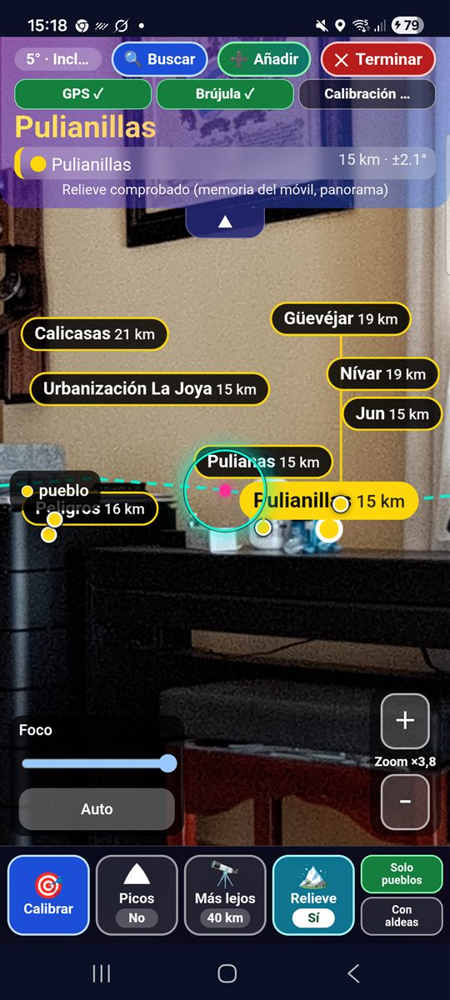
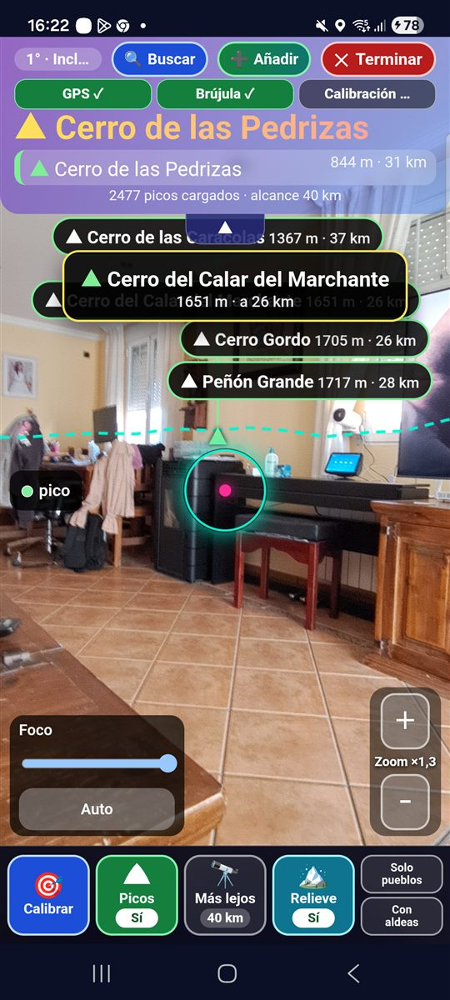
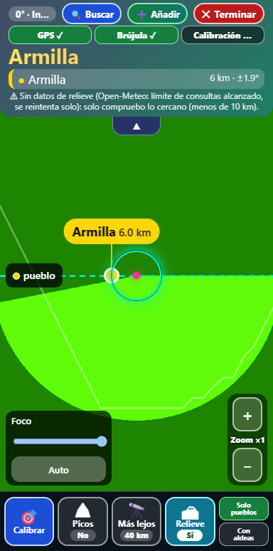
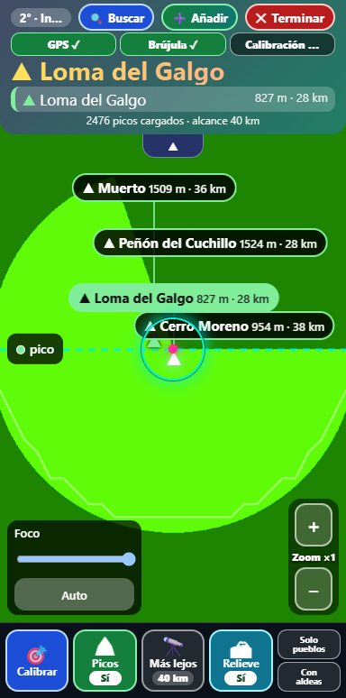

# Informe: comportamiento de las etiquetas y correcciones (v39 y v49)

Fecha: 14 nov 2026 · App: ¿Qué pueblo es? · Web/PWA `pueblos.marinweb.org`
Dispositivo observado: Samsung SM-A536B (Galaxy A53 5G), app instalada en Chrome.

---

## 1. Qué se ha hecho

- Se ha conectado el móvil por **ADB** y se ha enganchado el navegador interno por **Chrome DevTools**, de modo que además de la pantalla se leían las etiquetas reales (texto, posición, selección, botones y avisos).
- Se grabó una sesión de **20 minutos** de uso real y una segunda sesión de pruebas con picos.
- Se han corregido los fallos de etiquetas en `scripts/app.js` y `styles/camera.css`.
- Se ha subido la versión a **v39** (`index.html` y `sw.js`).
- Se ha probado la corrección en Chrome de escritorio con viewport de móvil (384×774), la posición real del móvil (37,0890, −3,6255, 843 m), cámara simulada y orientación simulada.

---

## 2. Qué se vio en la sesión real

### 2.1. Pueblos (15:19–15:22)

- Apuntando al norte desde el sur de Granada: la mira pasó por **Granada → Pulianillas → Urbanización La Joya → Maracena → Pulianas → Jun**.
- La etiqueta seleccionada cambiaba con el temblor de la brújula y el margen ± oscilaba entre **0,0° y 3,0°**.
- La **leyenda lateral** se montaba encima de etiquetas que caían en el borde izquierdo (Maracena, Peligros).
- Varias etiquetas quedaban pegadas al borde sin línea al punto cuando el punto se salía de pantalla.

### 2.2. Picos (16:17–16:22)

- A las **16:17:30** se pulsa **⛰ Picos**: se cargan **2.477 picos** y se apaga «Solo pueblos» (los filtros son excluyentes).
- La mira salta entre picos casi alineados: **112 cambios de pico en 2,5 min** y **44 cambios en 45 s**.
- El pico que nombre el panel grande **no tiene etiqueta visible**: le pasó a *Cerro del Chapa*, *Loma del Juncarón*, *Cerro de la Cruz*, *Cerro de las Pedrizas*, *Cerro de los Prados*…
- Al tocar una etiqueta de pico, el **bocadillo amarillo duplica** la etiqueta que ya está dibujada y tapa las de al lado.
- El **botón de plegar (▲)** se dibuja encima de etiquetas (p. ej. «Cerro de las Caracolas» y «Cerro de la Cobertera»).
- Las etiquetas de pico son muy anchas: *Cerro del Calar del Marchante* llegó a **333 px de 384**.

### 2.3. Otras observaciones

- La calibración se quedó en **«Calibración…»** todo el tiempo, aunque la brújula marcaba ✓. No se ha tocado: depende de la precisión real del sensor y del entorno; conviene revisarlo aparte.
- Entre las 15:22 y las 16:13 el móvil estuvo boca arriba (inclinación −89°); la app mostró correctamente «Apunta hacia el horizonte…» y no dibujó etiquetas.

---

## 3. Correcciones aplicadas

### 3.1. El pico de la mira se dibuja y se resalta

`picoMira()` calcula el pico; ahora `pintar()` se lo pasa a `etiquetas(pe, hdc, pm)`. En el bucle de picos:

- el pico seleccionado se ordena **primero** y se dibuja **aunque no quepa** en el reparto normal;
- si su proyección cae detrás del panel o fuera por abajo, **su nombre se recoloca** para que se vea;
- se marca con `sel`: la etiqueta se rellena de verde y el triángulo se resalta (`.pk.sel`).

### 3.2. Histéresis de la selección

`picoMira()` guarda el pico elegido. Si otro pico está algo más centrado, **no cambia** hasta que pasen **2,5 s** o hasta que la diferencia sea mayor de **0,8°**. Así el panel y la etiqueta dejan de parpadear con el temblor normal de la brújula.

### 3.3. El toque sobre un pico ya dibujado no duplica el bocadillo

- Si la etiqueta del pico tocado ya está en pantalla, se **resalta** (nuevo `tapPico`) y se oculta el bocadillo.
- Si la etiqueta no estaba dibujada, se mantiene el bocadillo como respaldo.
- El resaltado se apaga solo a los 6 s.

### 3.4. Las etiquetas ya no se meten debajo de la interfaz

Antes de repartir etiquetas se añaden como zonas ocupadas:

- la pestaña **▲ de plegar**, que sobresale del panel;
- la **leyenda lateral** (`#leyenda`), que además crece cuando hay ciudad + pueblo.

### 3.5. Separación entre etiquetas

El apilado vertical pasa de **34 a 36 px**, de modo que dos etiquetas consecutivas de 32 px de alto dejan 4 px de aire y no se tocan.

### 3.6. Etiqueta de pico seleccionada sin desbordar

La etiqueta de pico conserva 15 px también cuando está seleccionada (`.et.pico`), para que un nombre largo no se salga de la pantalla al crecer a 18 px como las de pueblo.

### 3.7. Pruebas

- `tests/rumbo.js` y `tests/vista.js` no arrancaban: les faltaban `pitF`, `pkSel`, `pkSelT` y un `estabilizar()` simulado. Se han completado.
- Se ha añadido una prueba de la histéresis y otra del cambio a los 3 s.
- `tests/estatico.js` valida ahora la versión **v39** y el cache-bust unificado.

---

## 4. Verificación

| Comprobación | Antes (v38 real) | Después (v39) |
|---|---|---|
| Pico de la mira con etiqueta visible | No (solo en el panel) | **Sí, resaltado** |
| Cambios de pico con temblor | 112 en 2,5 min | **0 en 4,8 s con ±0,3°** |
| Etiquetas bajo el botón ▲ | Sí | **0 solapes** |
| Etiquetas bajo la leyenda | Sí | **0 solapes** |
| Etiquetas entre sí | Se tocaban | **0 solapes** (paso 36 px) |
| Toque en pico ya dibujado | Duplicaba bocadillo | **Resalta, sin bocadillo** |
| Pruebas `estatico`, `rumbo`, `vista` | — | **Todo correcto** |

La verificación visual se hizo con el código corregido en Chrome, a 384×774, con la posición real del móvil, cámara simulada y orientación simulada. Las capturas «después» son de esa prueba.

### Comparativa del solape corregido

Antes, la etiqueta seleccionada y la siguiente se tocaban:

---

## 5. Archivos tocados

- `scripts/app.js`
  - `picoMira()`: histéresis.
  - `etiquetas(pe, hdc, pm)`: pico seleccionado, obstáculos, paso 36, `sel` en picos.
  - `identificarToque()` / `finToque()`: resaltado del pico tocado sin bocadillo duplicado.
  - `pintar()`: pasa `pm` a `etiquetas`.
- `styles/camera.css`
  - `.et.pico`, `.et.pico.sel`: tamaño estable.
  - `.pk.sel`: triángulo resaltado.
- `tests/rumbo.js`, `tests/vista.js`: stubs y prueba de histéresis.
- `index.html`, `sw.js`: versión **v39**.

---

## 6. Cómo probarlo

1. Publicar la v39 (GitHub Pages) o abrir la copia local servida por HTTP.
2. En el móvil, entrar y activar **Picos**.
3. Comprobar que el pico del panel grande tiene su etiqueta verde rellena en pantalla.
4. Mover el móvil despacio: el panel debe mantenerse estable y no saltar entre picos casi alineados.
5. Tocar una etiqueta de pico: debe resaltarse, sin abrir un bocadillo que la duplique.
6. Comprobar que ninguna etiqueta queda debajo del botón ▲ ni de la leyenda.

## 7. Estado de publicación

- Publicado en `origin/main` (commit `b34d7b1`).
- Verificado en la web: `index.html` y todos los recursos cargan con `?v=39`; el pie muestra **web 39**; sin errores de consola.
- Verificado en el móvil: tras recargar, la app muestra **web 39**.
- La app queda en la pantalla de inicio; al pulsar «Iniciar identificación» ya usa el motor corregido.

## 8. Pendiente

- Revisar por separado por qué la calibración se queda en «Calibración…» en interiores.
- Valorar acortar nombres de pico muy largos (o partir altura/distancia en dos líneas) para que no ocupen casi todo el ancho.

---

## 9. Revisión v49: la reserva vertical no cubría la etiqueta

Fecha: 16 nov 2026 · Web v49 · Samsung SM-A536B (`RZCW20RKTCR`), Chrome del móvil por CDP.

### 9.1. Cómo se ha medido

- Se engancha la pestaña del móvil con `adb forward tcp:9333 localabstract:chrome_devtools_remote`.
- La app va dentro de un IIFE, así que no se tocan sus variables: se leen las etiquetas reales del DOM (`#etq`), con su texto y su rectángulo.
- Para que la prueba sea repetible, se interceptan los eventos de orientación antes de cargar la página y se les da rumbo y cabeceo conocidos; la ubicación se fija con `Emulation.setGeolocationOverride`.
- Se barren **24 rumbos × 15°** en el Puerto de Navacerrada y en Fuente Dé (Picos de Europa), más un barrido de inclinación (de 10° a −70°). Viewport real: 384 × 718 px CSS.

### 9.2. Qué se ha visto

Lo que funciona bien (24 rumbos, 115–142 etiquetas por recorrido):

| Comprobación | Resultado |
|---|---|
| Etiquetas fuera de pantalla | **0** |
| Etiquetas debajo del panel o del botón ▲ | **0** |
| Desbordamiento horizontal | **0** |
| Nombres largos | se cortan con «…» («Cabeza de Hierro…», «Risco de los…») |
| Leyenda lateral | muestra «pico» solo cuando hay picos |
| Máximo de etiquetas en un rumbo | 10 (el motor corta en 12) |
| Errores de consola | 0 |

El defecto: **dos etiquetas seguidas se tocan por el borde**. En el barrido de Navacerrada aparecieron **19 solapes** y en Fuente Dé **26**, todos de **1–2 px verticales** y con mucha anchura compartida: los bordes verdes quedan pegados y parecen una sola pastilla.

Causa medida: la etiqueta real mide **33 px** de alto (15 px de letra + 8 px de relleno + 4 px de borde), pero `hueco()` reservaba solo **31 px** para decidir si cabe. Dos picos con una separación vertical de 31–32 px se daban por buenos y sus bordes se solapaban. El ancho no influye: en 115 etiquetas medidas, el ancho reservado nunca fue menor que el real (iba 25–30 px por encima).

### 9.3. Corrección

En `scripts/app.js`, `hueco()`: la reserva pasa de `c:y2-31` a `c:y2-34` (33 px reales + 1 px de aire). El escalón sigue en 36 px.

| Reserva | Navacerrada | Fuente Dé | Madrid |
|---|---|---|---|
| 31 px (antes) | 138 etiquetas · **27 solapes** | 139 · **36** | 110 · **4** |
| **34 px (ahora)** | 115 · **0** | 128 · **0** | 105 · **0** |
| 36 px (probado y descartado) | 111 · 0 | 128 · 0 | 75 · 0 |

Cifras de una simulación que ejecuta el `etiquetas()` real de `app.js` con los 42.920 picos del mapa, 24 rumbos y el mismo viewport. Se descartó 36 porque en zonas con muchos pueblos cuesta un 30% de etiquetas sin ganar nada frente a 34.

Comprobado además en el móvil con la reserva de 36 px: 24 rumbos, **0 solapes** (antes 19). Con 34 px la comprobación en el móvil quedó pendiente porque el proveedor de relieve (Open-Meteo) agotó la cuota del día a fuerza de repetir los barridos.

### 9.4. Lo que queda

- Repetir el barrido en el móvil con la reserva de 34 px cuando vuelva la cuota de relieve.
- Caso raro visto una vez, a −15° de inclinación: dos picos separados 11 px en vertical, con el panel tapando el espacio de arriba, dejan la etiqueta elegida forzada al nivel 0 y se solapan 22 px. La regla «el pico de la mira siempre se dibuja» hace que se prefiera el solape a esconderlo; habría que decidir si se permite apilar hacia abajo en ese caso.

### 9.5. Pruebas

`tests/estatico.js` comprueba ahora que la reserva vertical es de 33 px o más y que el CSS de la etiqueta sigue midiendo 33 px (letra 15, borde 2). Las cinco pruebas sin navegador pasan en v49.

